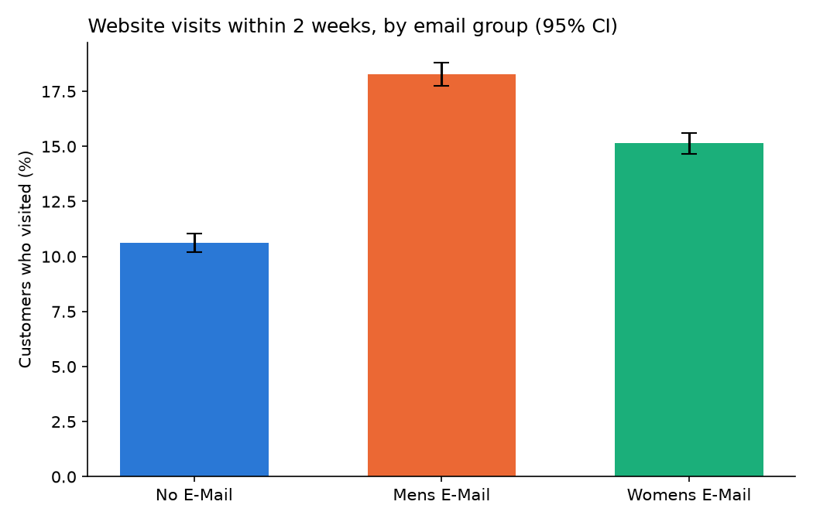
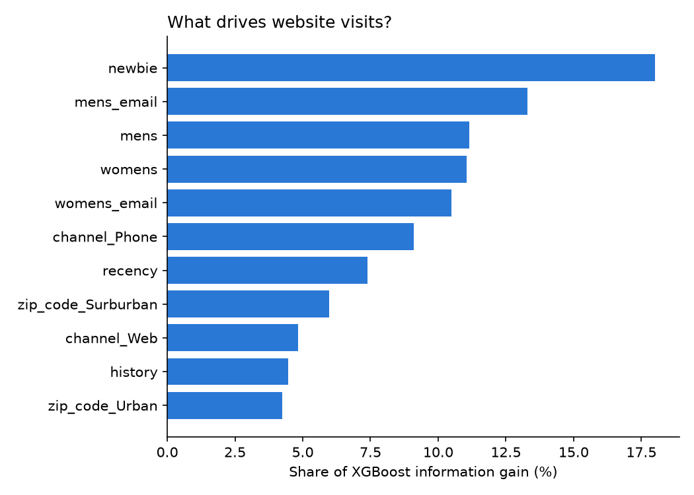
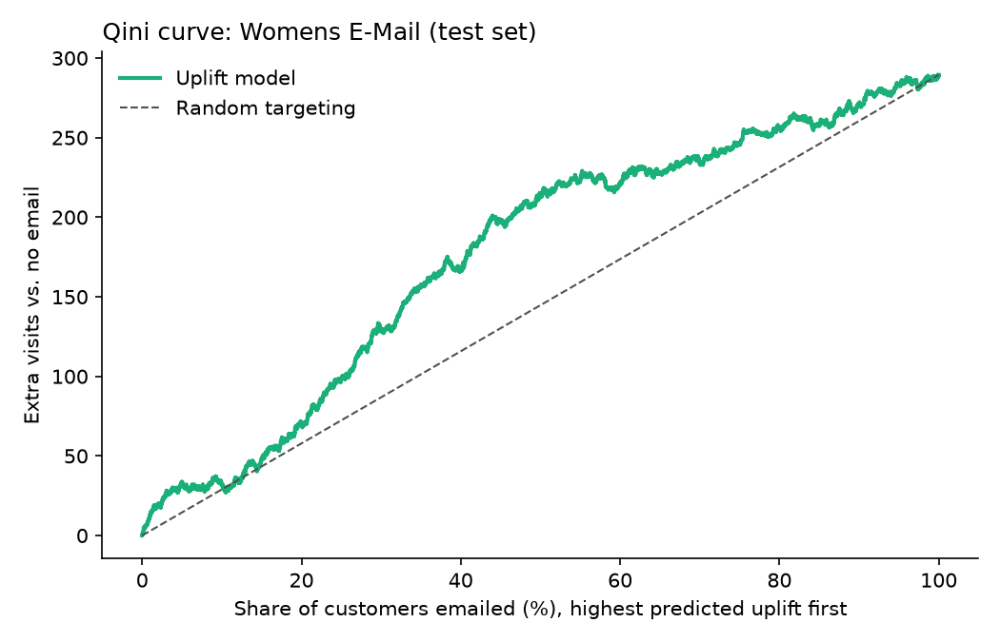
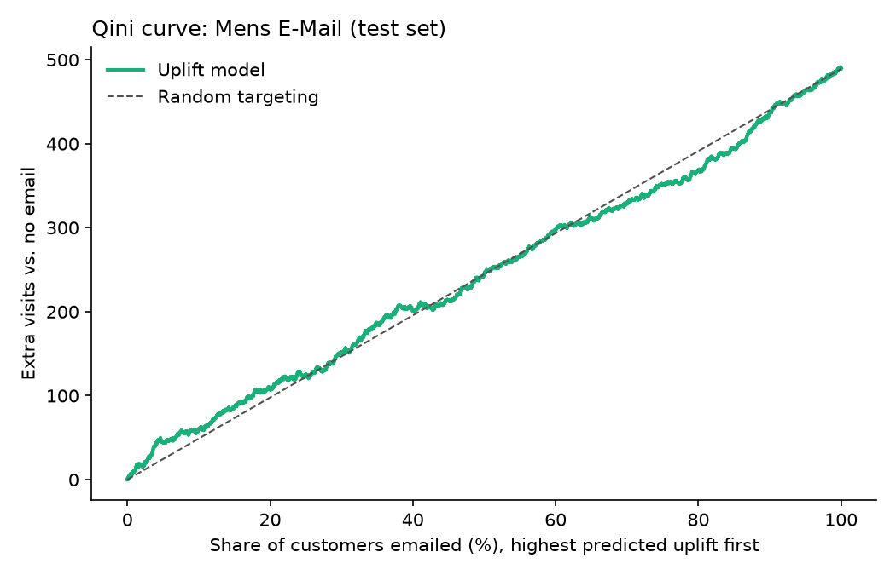

# Email Marketing A/B Test + Machine Learning: Who Should Get the Email?

**Question:** An online retailer emailed 64,000 customers in a randomized test: a men's email, a women's email, or no email. Do the emails work, and can machine learning tell us *which* customers to email?

**Answer:** Both emails significantly increase website visits, but **the men's email wins everywhere**: it lifts visits by 7.7 points overall and works for every customer group, including women's-only buyers. The best strategy is to **send the men's email to everyone** (about $2,850 net value per 100,000 customers under stated assumptions, roughly double the best women's-email plan). An XGBoost uplift model confirmed these patterns but **did not beat a simple rule**, and testing it against that rule is what revealed the answer.

## Key findings

| Comparison (vs. No E-Mail) | Visit rate | Lift | 95% CI | Holm-adjusted p |
|---|---|---|---|---|
| Mens E-Mail | 18.28% vs. 10.62% | +7.66 pts | +7.00 to +8.32 | < 0.0001 |
| Womens E-Mail | 15.14% vs. 10.62% | +4.52 pts | +3.89 to +5.16 | < 0.0001 |

1. **Both emails work, and the experiment is trustworthy.** Groups are almost exactly one-third each (SRM p = 0.90), customer features are balanced, and both lifts stay significant after correcting for four tests. Conversions rise too.
2. **What drives visits:** XGBoost and logistic regression tied (test ROC AUC 0.648 each; decision tree 0.618), so the simpler, explainable model is preferred. New customers have 42% lower visit odds; the men's email multiplies visit odds by 1.89 and the women's by 1.51. Customer history accounts for about half of XGBoost's gain: who the customer already is matters as much as the email.
3. **The men's email helps nearly everyone:**

   | Buyer type (last year) | Customers | Men's email uplift | Women's email uplift |
   |---|---|---|---|
   | Bought both | 6,448 | **+13.4 pts** | +7.1 pts |
   | Men's only | 28,818 | **+6.9 pts** | +1.1 pts |
   | Women's only | 28,734 | +7.1 pts | +7.4 pts (tie, within noise) |

4. **ML vs. a simple rule:** for the women's email, the rule "email only past women's buyers" (55% of customers) kept about 94% of the extra visits; the uplift model's top 55% kept about 79% (Qini 31.8). For the men's email, uplift was flat across deciles (Qini −0.1): there was no one to target because the email works on everyone.
5. **Recommendation:** send the men's email to all customers and retire the women's email. An email pays for itself only above 2 points of uplift ($0.01 cost, $0.50 per visit, both assumptions); the women's email falls below that for men's-only buyers (+1.1).






## Approach

1. **Classic A/B test** (`notebooks/01_ab_test.ipynb`): sample-ratio and balance checks, power analysis, two-proportion z-tests with confidence intervals, Holm correction, and a bootstrap for spend.
2. **ML driver models** (`notebooks/02_ml_drivers.ipynb`): logistic regression, decision tree and XGBoost predict visits from customer features plus email group, following the A/B-testing-with-ML approach of [sayakpaul/A-B-testing-with-Machine-Learning](https://github.com/sayakpaul/A-B-testing-with-Machine-Learning) (based on Matt Dancho's Business Science tutorial). Compared on test-set ROC AUC; drivers explained with odds ratios and XGBoost gain.
3. **Uplift model** (`notebooks/03_uplift.ipynb`): a T-learner (two XGBoost models, one for emailed customers and one for control) estimates each customer's *extra* chance of visiting because of the email. Evaluated on a held-out 30% with uplift-by-decile, Qini curves, and a head-to-head test against a simple business rule, then turned into a cost-based recommendation.

## Validation
- 12 unit tests (`pytest -q`), including tests that the uplift code finds a planted effect and that random scores give a near-zero Qini.
- z-test results match an independent Excel calculation.
- Average predicted uplift matched actual uplift on the test set (0.045 vs. 0.045 women's; 0.077 vs. 0.077 men's).
- Only pre-email customer features are used in ML; outcomes are never features.

## Limitations
- The data is from 2008 and covers a two-week window.
- Each customer received at most one email, so the effect of receiving both is unknown.
- Uplift models are noisy: the T-learner overestimated the top decile (+12.0 predicted vs. +5.0 actual) and only nine customer features were available.
- Email cost and visit value are assumptions, not measured; the recommendation should be confirmed with a follow-up test.

## Run it

```bash
python -m venv .venv
.venv\Scripts\activate          # Mac/Linux: source .venv/bin/activate
pip install -r requirements.txt
python src/get_data.py
pytest -q
```
Then open the three notebooks in `notebooks/` and run all cells.

*Data: Kevin Hillstrom's MineThatData E-Mail Analytics Challenge (2008), a public dataset widely used for uplift modeling.*